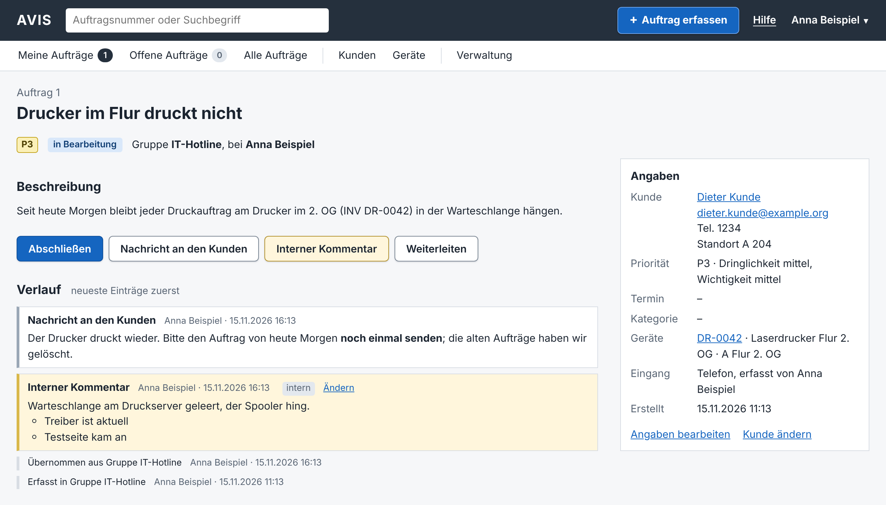

# AVIS

AVIS (Auftrags-, Verfolgungs- und Informationssystem) ist ein schlankes
Ticketsystem für die IT: Aufträge erfassen, an eine Gruppe geben, übernehmen,
erledigen. Kunden stellen und verfolgen ihre Aufträge im Browser oder per
E-Mail.

Es ist für eine IT-Abteilung mit einigen Dutzend Bearbeitern gedacht und
bleibt mit Absicht klein: eine Webanwendung mit einer Datenbankdatei, ohne
einstellbare Abläufe und ohne Dienste daneben.



*Ein Auftrag aus Sicht eines Bearbeiters, mit den erfundenen Testdaten.*

## Was AVIS kann

**Für Bearbeiter**

- Aufträge erfassen, übernehmen, an eine andere Gruppe weiterleiten,
  abschließen und wieder öffnen
- Interne Kommentare, die der Kunde nie sieht, getrennt von Nachrichten an
  den Kunden
- Ein lückenloser Verlauf: Wer hat wann was getan
- Listen für das, was ich bearbeite und was in meinen Gruppen offen liegt,
  sortiert nach Priorität; Suche über alle Aufträge
- Gesperrte Gruppen für Vertrauliches, deren Aufträge nur ihre Mitglieder
  sehen
- Kunden und Geräte mit ihren bisherigen Aufträgen
- Geräte und andere Aufträge verknüpfen, indem man sie im Text nennt
  (`INV 4711`, `AVIS 123`), ohne Teilaufträge und Abhängigkeiten

**Für Kunden**

- Einen Auftrag stellen und den Stand der eigenen Aufträge sehen
- Der IT antworten und einen abgeschlossenen Auftrag wieder öffnen
- Beides auch per E-Mail

**E-Mail**

- Mails an den Kunden bei Erfassung, Nachricht und Abschluss; an Bearbeiter
  nur, wenn es sie betrifft
- E-Mail-Eingang: Eine Mail an die Hotline wird ein Auftrag, eine Antwort
  landet im richtigen Auftrag

**Anbindungen**, jede einzeln abschaltbar

- Anmeldung über Windows und Active Directory, ohne Passworteingabe
- Bearbeiter und Kunden aus dem Active Directory, Geräte aus Snipe-IT; AVIS
  liest dort nur

**Außerdem**

- Texte mit Markdown, Vorschau, Bildschirmfotos einfügen mit Strg+V, Anhänge
- Hilfe in der Anwendung für Kunden, Bearbeiter und Administratoren
- Helle und dunkle Darstellung
- Funktioniert auch ohne JavaScript

Was AVIS mit Absicht nicht hat: einstellbare Workflows, frei definierbare
Felder, SLA-Uhren, Zeiterfassung und Auswertungen pro Bearbeiter. Die Gründe
stehen im [Konzept](docs/konzept.md).

## Stand

Alles oben Genannte ist gebaut und wird automatisch getestet, unter Windows
und Linux. **Im Alltag ist AVIS noch nicht erprobt.** Ein Probelauf in einer
echten Umgebung läuft: Dort haben die Windows-Anmeldung unter IIS, die
Abgleiche mit Active Directory und Snipe-IT, der Mailversand und der
E-Mail-Eingang funktioniert. Der Betrieb über längere Zeit steht noch aus.

Die Versionen stehen unter
[Releases](https://github.com/T3chSynergy/avis/releases), jede mit ihrem
Paket für Windows Server. Solange die Versionsnummer mit 0 beginnt, kann sich
von einer Version zur nächsten noch Grundlegendes ändern.

Was genau ungeprüft ist, welche Lücken bekannt sind und was als Nächstes
ansteht, steht in [Stand und Ausblick](docs/stand.md).

## Ausprobieren

Nötig ist nur das .NET 10 SDK, unter Windows oder Linux.

```bash
dotnet run --project src/Avis.Web
```

AVIS läuft dann unter http://localhost:5274 mit erfundenen Testdaten. Statt
einer Anmeldung wählt man einen der Testbenutzer: einen Administrator,
Bearbeiter oder einen Kunden. Mails gehen an niemanden, sie landen als Dateien
in einem Ordner. Mehr dazu steht unter [Entwicklung](docs/entwicklung.md).

## Betreiben

AVIS läuft unter Windows Server mit IIS. Für den Betrieb hängt an jedem
[Release](https://github.com/T3chSynergy/avis/releases) ein fertiges Paket.

- [Betrieb unter IIS](docs/betrieb-iis.md): Einrichtung und Update
- [Einstellungen und Anbindungen](docs/einstellungen.md): was sich einstellen
  lässt und wie sich Mailversand, E-Mail-Eingang und die Abgleiche verhalten

## Dokumentation

| Für wen | Wo |
|---|---|
| Wer AVIS kurz kennenlernen will | [Kurzvideos](https://t3chsynergy.github.io/avis/) mit den wichtigsten Handgriffen für Bearbeiter, zusammen rund acht Minuten, und die [Kurzanleitung für Bearbeiter](https://t3chsynergy.github.io/avis/kurzanleitung.html) mit Bildern, auch als PDF |
| Kunden, Bearbeiter, Administratoren | Die Hilfe in der Anwendung, „Hilfe“ im Kopf jeder Seite. Hier zum Nachlesen: für [Kunden](src/Avis.Web/Hilfe/kunden.md), [Bearbeiter](src/Avis.Web/Hilfe/bearbeiter.md) und [Administratoren](src/Avis.Web/Hilfe/administratoren.md) |
| Wer AVIS betreibt | [Betrieb unter IIS](docs/betrieb-iis.md), [Einstellungen und Anbindungen](docs/einstellungen.md) |
| Wer wissen will, warum AVIS so ist | [Konzept](docs/konzept.md) |
| Wer wissen will, wie weit es ist | [Stand und Ausblick](docs/stand.md) |
| Wer mitentwickelt | [CONTRIBUTING.md](CONTRIBUTING.md), [Entwicklung](docs/entwicklung.md) |
| Wer eine Sicherheitslücke melden will | [SECURITY.md](SECURITY.md) |

## Technik

ASP.NET Core mit Razor Pages auf .NET 10, Entity Framework Core und SQLite.
Die Seiten erzeugt der Server; ein paar kleine eigene Skripte machen sie
bequemer, ein JavaScript-Framework gibt es nicht. Fremde Komponenten sind
wenige: MailKit für Mail, Markdig für Markdown, siehe
[`THIRD-PARTY-NOTICES.md`](THIRD-PARTY-NOTICES.md).

## Mitmachen

Fehlerberichte, Wünsche und Pull Requests sind willkommen, siehe
[CONTRIBUTING.md](CONTRIBUTING.md). Für den Umgang miteinander gilt der
[Verhaltenskodex](CODE_OF_CONDUCT.md). Sicherheitslücken bitte nicht
öffentlich melden, sondern vertraulich: siehe [SECURITY.md](SECURITY.md).

## Lizenz

AVIS ist freie Software: Sie können es unter den Bedingungen der **GNU Affero
General Public License**, Version 3 oder (nach Ihrer Wahl) jeder späteren
Version, weitergeben und/oder verändern (`AGPL-3.0-or-later`, siehe
[`LICENSE`](LICENSE)). Das Programm wird ohne jede Gewährleistung
bereitgestellt.

- Wer AVIS weitergibt, auch als gebaute Anwendung, muss den Quelltext unter
  derselben Lizenz zugänglich machen.
- Wer eine veränderte Fassung betreibt, muss deren Benutzern den Quelltext
  dieser Fassung anbieten. Dafür steht am Ende der Hilfe, die von jeder Seite
  aus erreichbar ist, der Verweis „Quelltext und Lizenz“. Seine Adresse steht
  in `src/Avis.Web/Lizenz.cs` und ist bei einer veränderten Fassung auf deren
  Quelltext zu ändern.
- Die mitgelieferten Komponenten behalten ihre eigenen Lizenzen (MIT,
  BSD-2-Clause, Apache-2.0), siehe
  [`THIRD-PARTY-NOTICES.md`](THIRD-PARTY-NOTICES.md).
- Wer einen Pull Request stellt, erklärt sich einverstanden, dass sein Beitrag
  unter derselben Lizenz veröffentlicht wird.
